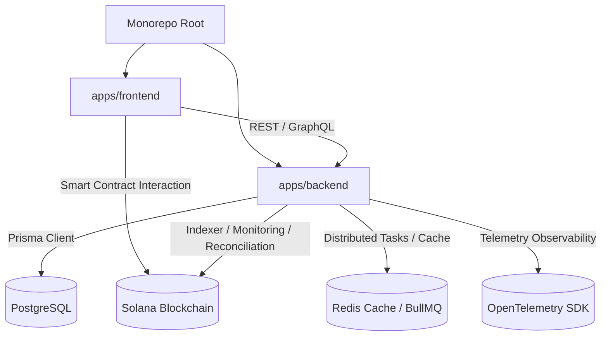
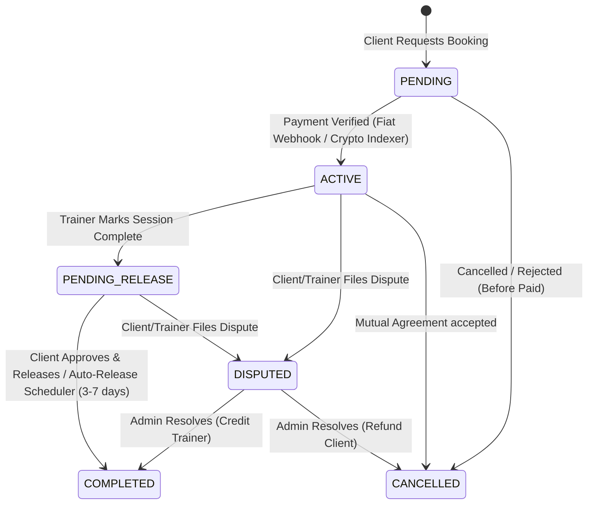

# ReLive: Architecture, Flows, and Feature Blueprint

This document serves as the absolute blueprint and status ledger for the **ReLive** monorepo. It outlines the technology stack, design system, core data flows, what has already been built, and features prepared for future development.

---

## 1. Monorepo Architecture & Tech Stack

ReLive is managed as a monorepo via `pnpm` workspaces:



### Technology Matrix

*   **Global Tooling:** `pnpm` Workspaces, Turborepo, TypeScript 5+, ESLint flat configs (v9).
*   **Backend (`apps/backend`):** 
    *   NestJS v11 (Modular Dependency Injection).
    *   GraphQL (Code-First) via `@nestjs/graphql` and Apollo Server.
    *   Prisma ORM mapping to PostgreSQL.
    *   Argon2 password hashing & Passport.js with JWT + Google OAuth 2.0.
    *   Redis Service for session caching & cache-aside strategies.
    *   BullMQ for distributed task processing and escrow release automation.
    *   OpenTelemetry NodeSDK for distributed tracing and centralized metrics logging.
    *   Transactional mailers via Nodemailer/Gmail SMTP.
    *   AI Integration via `openai` client (targeting DashScope/Qwen models).
*   **Frontend (`apps/frontend`):**
    *   Next.js v15 (App Router).
    *   Tailwind CSS v4 (incorporating shadcn-ui + Radix UI primitives).
    *   3D Rendering: React Three Fiber, Drei, Three.js, and BabylonJS.
    *   Animation Physics: Framer Motion and tsParticles (SVG custom shapes).
    *   Secure Session Management: Server-side encrypted HTTP-only session cookies synchronized with backend JWT token TTLs.
    *   Solana Wallet Adapter: `@solana/wallet-adapter-react` and standard UI adapters integrated globally for multi-wallet client-side signing.

---

## 2. Core Visual & Thematic Philosophy

Unlike traditional flat fitness dashboards, ReLive follows a **magical wellness / celestial world** aesthetic.

*   **Layout Constraints:** Highly centered, single-column user interfaces (avoiding developer-facing panels or side-by-side explanation grids).
*   **Glassmorphism & Lighting:** Heavy frosted cards (`backdrop-blur-xl`, subtle `border-white/20`) with absolute-positioned ambient radial-glow blobs in the background.
*   **Physics & Flow:** Spring-driven physics for dialogs/drawers and layout shifting via `framer-motion` layout animations.
*   **Environmental Cohesion:** Immersive 3D scenery (`/world`) acting as the spatial navigation hub for the user's health journey.

---

## 3. Core Application Flows & Ledger Status

### 🔐 Authentication, Session Hardening & Rate Limiting
*   **Status:** `[x] Implemented` (Redis exchange, sliding-window rate limiting, and CAPTCHA)
*   **The Flow:**
    1.  **Register:** User registers via `/auth/register`. Input data is validated on the frontend, and a Cloudflare Turnstile token is generated.
        *   **CAPTCHA Verification:** The frontend server action passes the token to the backend `register` mutation. The backend verifies the token against Cloudflare's Turnstile endpoint (`/siteverify`) prior to issuing activation credentials.
        *   A temporary activation token is generated, and a transactional activation link is emailed. No database record exists for the user until email verification is complete.
    2.  **Activation:** Clicking the activation link hits `GET /auth/activate`, checking for duplicates before instantiating the user record.
    3.  **Local Login:** Authenticates credentials via Argon2; returns generic error messages to prevent user enumeration.
    4.  **Google OAuth Login:** Hits `GET /auth/google/login`. On callback, the backend constructs a short-lived, single-use random handoff code.
        *   **Multi-Instance Safe Handoff:** The handoff code and safe auth payload are stored inside a shared Redis session cache with a strict 2-minute TTL.
        *   **Replay Protection:** The frontend exchanges this code via `/api/auth/google/callback`. The backend performs an atomic `GET` and `DEL` pipeline operation on Redis to fetch and invalidate the handoff payload in one trip, preventing replay attacks.
        *   This establishes an HTTP-only session cookie, preventing raw JWT tokens from leaking in browser history.
    5.  **Session Synced TTL:** Next.js session validation checks the inner JWT expiry claims to log users out concurrently with backend token expiration.

#### Multi-Instance Rate Limiting
*   **Proxy Trust:** Express is configured with `app.set('trust proxy', 1)` to correctly parse `X-Forwarded-For` proxy headers behind multi-instance load balancers, ensuring the real client IP is evaluated.
*   **Redis-Backed Sliding-Window Throttler:** Stricter rate limits (10 requests per minute) are enforced globally on heavy unauthenticated operations (`signIn`, `register`, `forgotPassword`, `resetPassword`, `/auth/activate`) using the shared Redis backend cache to prevent brute-force exhaustion attacks.

---

### 🗺️ Interactive 3D World (`/world`)
*   **Status:** `[x] Implemented`
*   **The Flow:**
    1.  Acts as the exploratory landing zone for wellness features.
    2.  A full-screen Three.js/BabylonJS canvas loads a interactive fantasy-style map.
    3.  Locations are highlighted as hotspots (e.g., Nutrition Hub, Astral Profile, Workout Workshop) which route the user cleanly between the 3D exploration scene and specific dashboard tools.

---

### 🥦 Nutrition Hub (`/foods`)
*   **Status:** `[x] Implemented` (Unified search, Redis cache-aside, & Postgres persistence)
*   **The Flow:**

```mermaid
sequenceDiagram
    participant User as Client Browser
    participant FE as Frontend Service
    participant BE as Backend Controller/Resolver
    participant RC as Redis Cache
    participant DB as Postgres Cache
    participant USDA as USDA API (Primary)
    participant OFF as Open Food Facts (Fallback)

    User->>FE: Types "Protein Bar" (Debounced)
    FE->>BE: Query /api/foods or GraphQL searchFoods
    BE->>RC: Check Redis Search Cache
    alt Redis Hit
        RC-->>BE: Return Cached Results (24h TTL)
    else Redis Miss
        BE->>DB: Check local FoodCache in DB
        alt DB Cache Hit
            DB-->>BE: Return Cached Food Results
            BE->>RC: Write results to Redis Search Cache (24h TTL)
        else DB Cache Miss
            BE->>USDA: Fetch primary raw foods API
            alt USDA Has Results
                USDA-->>BE: Return USDA Foods
                BE->>DB: Save normalized foods to database cache
                BE->>RC: Write results to Redis Search Cache (24h TTL)
            else USDA Empty/Fails
                BE->>OFF: Fetch fallback branded products
                OFF-->>BE: Return Branded Foods
                BE->>DB: Save normalized products to database cache
                BE->>RC: Write results to Redis Search Cache (24h TTL)
            end
        end
    end
    BE-->>FE: Return Normalized Food Array (per-100g metrics)
    FE->>User: Recalculate nutrients based on serving size locally & display
```

#### Persisted Favorites & Meal Plans
*   **Database Integration:** User favorites (`UserFavoriteFood` model) and aggregate meal items (`UserMealItem` model) are stored directly in the PostgreSQL database.
*   **State Synchronization:** Upon login or page mount, the frontend `useFoodSearch` hook auto-merges local browser state with the user's PostgreSQL account for seamless persistence.
*   **Write Debouncing:** A 1000ms debounce buffer is applied on serving size modifications to prevent excessive database writes while maintaining a highly reactive user interface.

---

### 📜 Scroll Cookbook (`/cookbook`)
*   **Status:** `[x] Implemented`
*   **The Flow:**
    1.  Presented in a stylized visual parchment/scroll theme.
    2.  Search terms are validated by Zod and submitted via server actions.
    3.  The backend follows a similar caching strategy: checks `RecipeCache` -> Spoonacular API (Primary) -> TheMealDB API (Fallback).
    4.  Recipes display full lists of ingredients, cooking steps, and general macros.
    5.  **Cross-linking:** Clicking an ingredient in a recipe routes the client directly to `/foods` with that ingredient pre-filled.

---

### 🏋️ Set Calculator, Workout Logs, & AI Coaching (`/set`)
*   **Status:** `[x] Implemented` (Postgres table partitioning & auto-provisioning enabled)
*   **The Flow:**
    1.  **Input:** User selects an exercise and inputs weight, reps, and RIR (Reps in Reserve).
    2.  **Category Routing:** The backend routes calculation tasks based on exercise categories using a Strategy pattern:
        *   `LOWER_BODY_COMPOUND` -> Brzycki formula.
        *   `UPPER_BODY_TECHNICAL` -> Wathan formula.
        *   `METABOLIC_CARDIO` -> Cardio Load strategy (evaluating RPE, density, and duration).
    3.  **Range-Partitioned Storage:** Workout sets are stored in a range-partitioned `WorkoutSet` table (partitioned by range on `createdAt` with a composite primary key `(id, createdAt)`).
        *   **Dynamic Partition Provisioning:** To prevent the "13-month cliff" where all historical records fall back to a single default partition, a weekly repeatable BullMQ job (`partition-provisioner`) programmatically inspects and pre-creates table partitions for the current and subsequent two months ahead.
    4.  **CNS Fatigue Detection:** The backend monitors daily deviations. If a user's calculated 1RM drops abnormally, the record is flagged as `isCnsFatigue` using its composite key (`id_createdAt`) to prevent bad-day outliers from poisoning the user's baseline.
    5.  **Safety Envelope AI Coaching:** When requesting a routine recommendation (`POST /recommendations`), the server calculates a strict numerical safety boundary (safe sets, reps, and weight ranges). It feeds this context to a local `qwen-plus` model via a dense system prompt that instructs the LLM *not* to recalculate the numbers. The model generates advice, which is clamped by the backend safety envelope before reaching the user.

---

## 4. Payment Payouts, RPC Redundancy & Telemetry

### 🤝 Trainer Marketplace & Booking Lifecycle
*   **Status:** `[x] Implemented` (Distributed release queues, Outbox events, & Web3 reconciliation)
*   **The Flow:**



#### Dual-Currency Escrow Payouts & Distributed Automation

1.  **Fiat (IDR via Duitku):**
    *   **Payment & Activation:** Client pays. The Duitku webhook verifies the payment and transitions status to `ACTIVE`.
    *   **Marking Complete:** Trainer clicks **"Mark Complete & Request Payment"**. The database transitions booking to `PENDING_RELEASE`.
    *   **Transactional Outbox & BullMQ Auto-Release:**
        *   To avoid dual-write inconsistencies, the status transition and outbox event (`OutboxEvent` table) are written atomically in a single Prisma transaction (`$transaction`).
        *   A dedicated relay worker (`outbox.processor.ts`) processes events from the outbox table every 5 seconds and schedules a delayed BullMQ job (`escrow-release` queue) with a 3-to-7 day delay config.
        *   Using BullMQ on top of Redis locks and distributes tasks across worker nodes, preventing `@nestjs/schedule` cron race conditions in a multi-instance load balancer.
    *   **Release & Approval:** Client clicks **"Approve & Release Payment"** (or the BullMQ auto-release scheduler triggers). The transaction transitions status to `COMPLETED`, cancels/removes any pending BullMQ auto-release job, and credits the trainer's `FiatWallet` balance.
    *   **Withdrawal:** Trainer requests withdrawal -> Deducts balance first -> Disburses bank payment via Duitku APIs.

2.  **Crypto (USDC on Solana):**
    *   **On-Chain Deposit:** Client triggers a deposit transaction using `@solana/wallet-adapter-react` to lock USDC inside the Solana escrow PDA contract.
    *   **Redundant Multi-RPC Indexer & Heartbeat:**
        *   The indexer evaluates a list of comma-separated RPC endpoints (`SOLANA_RPC_URLS`).
        *   A 30-second heartbeat check queries the active connection node (`connection.getSlot()`). If slot fetches fail or time out twice consecutively, the subscription is recycled, rotating to the next fallback Solana RPC endpoint.
        *   **Synchronous Failover Backfill:** Upon failover reconnect, the indexer triggers a backfill loop using `connection.getSignaturesForAddress()` for all `PENDING` bookings with derived escrow addresses, ensuring no transactions confirmed during socket downtime are lost.
    *   **Marking Complete:** Trainer clicks **"Request release"** on their dashboard -> transitions booking status to `PENDING_RELEASE`.
    *   **Client Approval:** Client clicks **"Approve & Release Escrow"** on their dashboard -> transitions booking status to `COMPLETED`.
    *   **On-Chain Claim:** The trainer clicks **"Claim USDC Escrow"** from the trainer bookings table. The dashboard initiates a Solana transaction signing requesting the release instructions from the backend, then signs and broadcasts it to physically transfer USDC from the escrow PDA to the trainer's wallet.
    *   **Client Refund:** If cancelled, client clicks **"Claim Refund"** -> signs/broadcasts refund transaction -> transfers USDC from the escrow PDA back to client's wallet.

---

## 5. Telemetry & Observability Hardening
*   **Dynamic Key Vaulting:** Hot-wallet authority keys are retrieved dynamically on-demand from AWS Secrets Manager / Vault instead of exposing secrets directly in environment files or container logs.
*   **Structured Telemetry Logs:** OpenTelemetry NodeSDK captures tracing spans and outputs standard metrics to stdout/console.
    *   **RPC Failover Tracing:** Spans record indexer connection swaps, slot exceptions, and backfill outcomes.
    *   **Rate-Limiting Spans:** Rate-limit violations are recorded as span events including IP address and endpoint path metadata, alerting security infrastructure automatically.
*   **Redis Search Cache-Aside:** External USDA API and Open Food Facts search requests are cached in Redis with a 24-hour TTL (`food:search:*`), protecting public APIs from local UI query storms.
